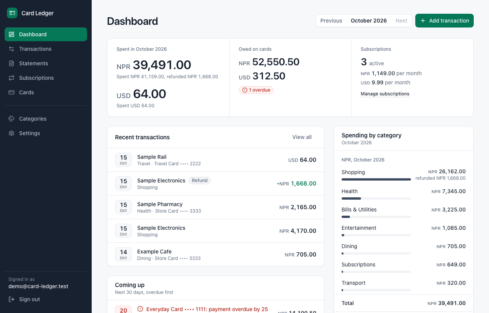
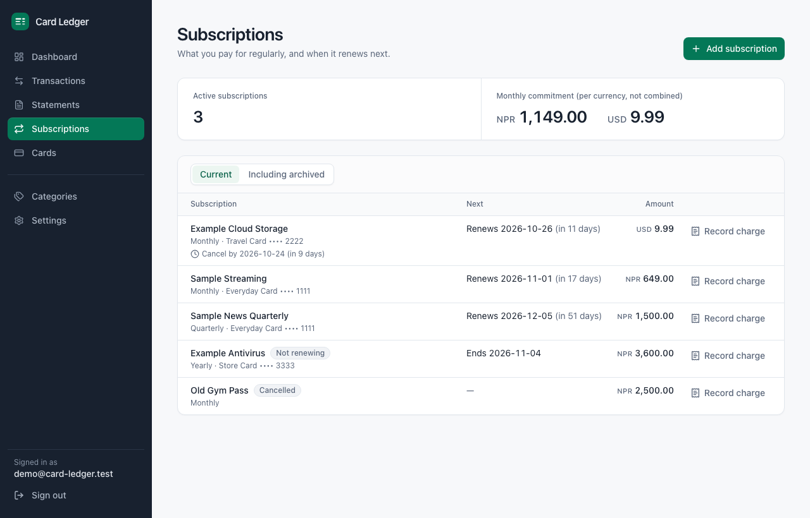
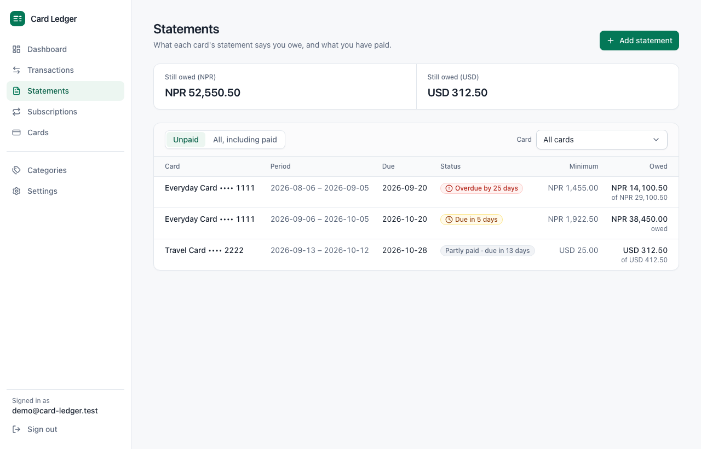
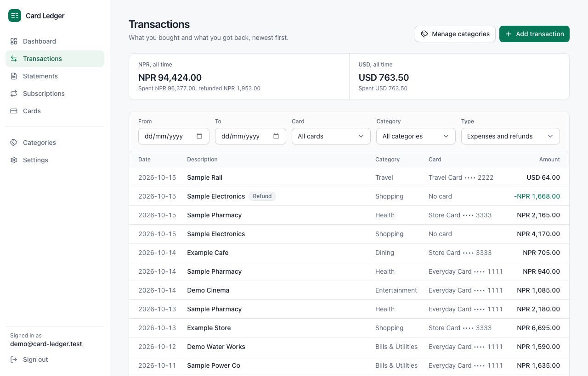
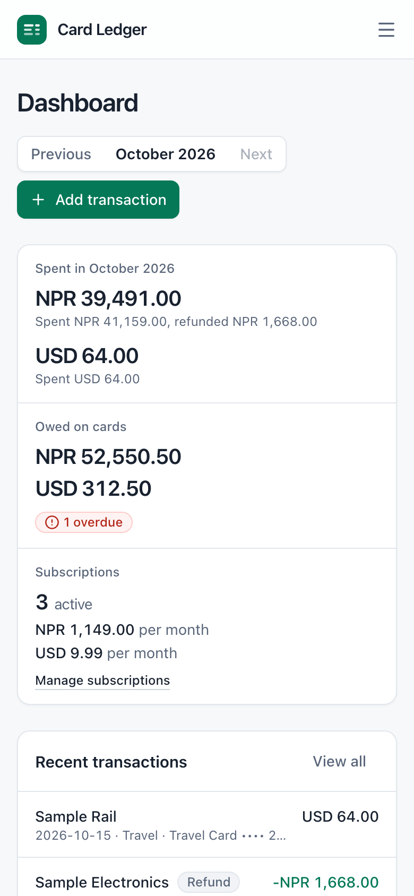

# Card Ledger

A self-hostable personal finance and subscription tracker. Keep your credit cards, subscriptions, spending, card statements and payment due dates in one place, get email reminders before money is due, and keep the data on a server you control.

> **Status: pre-1.0.** The core is built and tested, but Card Ledger has not had an independent security audit. Run it for yourself, keep it private, and read [SECURITY.md](./SECURITY.md) before exposing it to the internet.



*Screenshots show the synthetic demo account created by `pnpm run db:seed`. Nothing in them is real.*

## Principles

- **Self-hosted and complete.** One codebase, no editions, no feature locks, no licence keys.
- **No telemetry.** The only outbound connection at runtime is the SMTP server you configure, if any.
- **Minimal sensitive data.** Only the last four digits of a card are stored; never a full number, CVV, PIN or banking credential. There are no bank connections: you enter what you want to track.
- **Per-user isolation.** Every row belongs to a user and every query is scoped to the signed-in user.
- **Correct money.** Amounts are integer minor units with a currency code. Different currencies are never added together.

## What it does

- **Cards** (last four digits, currency, credit limit, statement and due days; archive instead of delete).
- **Subscriptions** that renew weekly, monthly, quarterly, yearly or every N units, with month-end-safe renewal dates, cancel and reactivate, expiry and cancel-by deadlines, and the monthly commitment per currency.
- **Transactions** with categories, partial or full refunds, filters you can share as a link, and totals per currency.
- **Card statements and payments**: what you owe the bank, due dates, overdue state and overpayment credit. Payments are not counted as spending.
- **Dashboard** for the current or any earlier month: spent per currency, subscription commitment, amounts owed, a 30-day "coming up" list and spending by category.
- **Email reminders** (optional SMTP) for renewals, expiries, cancel-by dates and card payments, as one digest per person per run, with no duplicates.
- **Your data stays yours**: export everything as JSON or CSV, delete your account, and back up the database.

<table>
  <tr>
    <td width="50%"></td>
    <td width="50%"></td>
  </tr>
  <tr>
    <td width="50%"></td>
    <td width="50%"></td>
  </tr>
</table>

## Quick start (self-hosting)

You need Docker with Docker Compose v2.

```bash
git clone https://github.com/haruBlank0-0/card-ledger.git
cd card-ledger
cp .env.example .env
```

Edit `.env` and set the two required secrets (`openssl rand -hex 24` for `POSTGRES_PASSWORD`, `openssl rand -base64 48` for `BETTER_AUTH_SECRET`), then:

```bash
docker compose up -d --build
```

Open <http://localhost:3000> (if another program already uses port 3000, set `APP_PORT` in `.env`, as the [self-hosting guide](./docs/self-hosting.md) explains). The first account you create becomes the owner and registration then closes. The app listens on `127.0.0.1` only; to use it from other devices put HTTPS in front of it, as described in the [self-hosting guide](./docs/self-hosting.md), which also covers email reminders, upgrades and troubleshooting. Set up [backups](./docs/backup-restore.md) before you rely on it.

## Development

Needs Node.js 24 (`nvm use` reads `.nvmrc`), pnpm (`corepack enable` provides the pinned version) and Docker.

```bash
pnpm install --frozen-lockfile
docker compose -f compose.dev.yaml up -d    # PostgreSQL and a mail catcher
# create .env.local (see CONTRIBUTING.md), then:
pnpm run db:generate && pnpm run db:migrate && pnpm run db:seed
pnpm run dev                                  # http://localhost:3100
```

Quality gates: `pnpm run check`, `pnpm run typecheck`, `pnpm test`, `pnpm run build`. Full setup and workflow: [CONTRIBUTING.md](./CONTRIBUTING.md).

Built with TanStack Start (React 19), PostgreSQL through Prisma, Better Auth, Tailwind CSS with shadcn/ui, Vitest and Biome.

## Documentation

| | |
|---|---|
| [Self-hosting guide](./docs/self-hosting.md) | install, first user, email, HTTPS and Tailscale access, upgrades, troubleshooting |
| [Backup and restore](./docs/backup-restore.md) | scheduled backups, restore, and the restore drill |
| [Architecture](./docs/architecture.md) | components, data isolation, security model, reminders |
| [Database](./docs/database.md) | tables and constraints |
| [Data format](./docs/data-format.md) | the JSON and CSV export |
| [Decision records](./docs/decisions/README.md) | why things are the way they are |
| [Roadmap](./docs/roadmap.md) | what is built and what is next |
| [Pre-publication audit](./docs/pre-publication-audit.md) | what was checked before publishing, and what was not |

## Security and privacy

Please report vulnerabilities privately; the process, scope and response targets are in [SECURITY.md](./SECURITY.md). A database backup contains every user's financial data: treat it like the live database and encrypt copies that leave your machine.

## Licence and contributing

Card Ledger is licensed under the [GNU Affero General Public License v3.0 only](./LICENSE) (`AGPL-3.0-only`). Contributions are accepted under the same licence with a Developer Certificate of Origin sign-off (`git commit -s`) and **no CLA**, so the code cannot later be relicensed without every contributor's consent. If you run a modified version as a network service, AGPL section 13 requires you to offer its source to your users.

Contributions are welcome: start with [CONTRIBUTING.md](./CONTRIBUTING.md). Everyone taking part is expected to follow the [Code of Conduct](./CODE_OF_CONDUCT.md).

## Roadmap

The MVP, self-hosting (Docker, backups, health checks) and the public-repository work (CI, security policy, templates, audit) are done. Candidates for later, to be prioritised from real feedback: CSV import of bank exports, recurring-transaction templates, user-provided exchange rates, more reminder channels, budgets and translations. See [docs/roadmap.md](./docs/roadmap.md).
